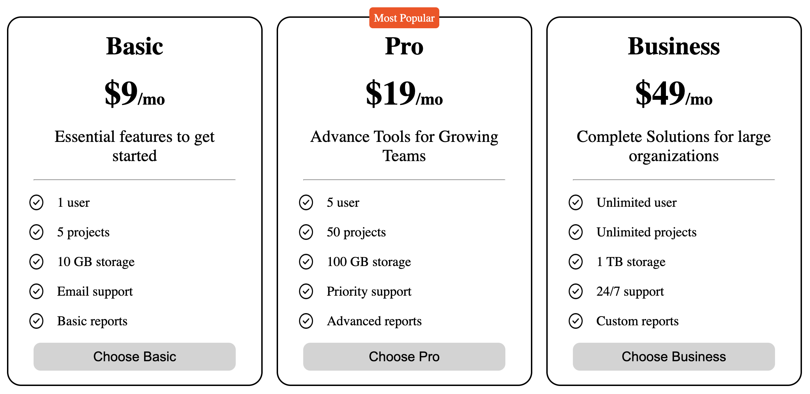
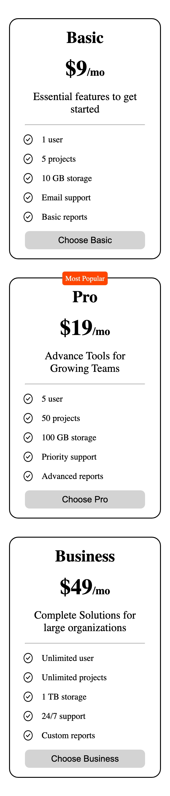

# Pricing Cards

A responsive row of three pricing cards built with plain **HTML** and **CSS**. This is a beginner frontend project from [roadmap.sh](https://roadmap.sh/projects/pricing-cards).

## Preview

### Desktop



### Mobile



## Features

- Three plan cards in a Flexbox row: **Basic ($9/mo)**, **Pro ($19/mo)** and **Business ($49/mo)**
- Each card shows a plan name, a price, a short tagline, a five-item feature list with tick icons, and a "Choose" button
- An orange **Most Popular** badge on the Pro card
- Hover effect on each card: the card scales up slightly, gains an orange border and a soft shadow, the plan name and price turn orange, and the button fills orange
- A separate hover state on the button (white background with an orange border)
- Responsive layout: below 768px the cards stack vertically in a single centered column

## Plans

| Plan     | Price   | Users     | Projects  | Storage | Support  | Reports  |
| -------- | ------- | --------- | --------- | ------- | -------- | -------- |
| Basic    | $9/mo   | 1         | 5         | 10 GB   | Email    | Basic    |
| Pro      | $19/mo  | 5         | 50        | 100 GB  | Priority | Advanced |
| Business | $49/mo  | Unlimited | Unlimited | 1 TB    | 24/7     | Custom   |

## Tech Stack

- HTML5
- CSS3 (Flexbox, `gap`, absolute positioning, `transform`, `box-shadow`, nested rules, media queries)

No JavaScript, frameworks or build tools are needed.

## Project Structure

```
Pricing-Cards/
├── src/
│   ├── index.html          # Markup for the three cards
│   ├── style.css           # All styles, including the mobile media query
│   └── images/
│       ├── tick-circle.png     # Icon used in the feature lists
│       ├── preview-desktop.png # Desktop preview used in this README
│       └── preview-mobile.png  # Mobile preview used in this README
└── README.md
```

## Getting Started

1. Clone the repository:

   ```bash
   git clone https://github.com/KunalGuhagarkar/Pricing-Cards.git
   cd Pricing-Cards
   ```

2. Open `src/index.html` in your browser. You can also serve the folder locally:

   ```bash
   npx serve src
   ```

## Possible Improvements

- Make all cards the same height so the buttons line up at the bottom when feature lists differ in length
- Add a visible keyboard focus state (`:focus-visible`) to the buttons
- Use semantic list markup (`<li>` directly inside `<ul>`) instead of wrapping each item in a `<div>`
- Use CSS custom properties for the accent color
- Add a monthly/yearly billing toggle once you learn JavaScript

## Credits

Project idea and requirements from [roadmap.sh: Pricing Cards](https://roadmap.sh/projects/pricing-cards).

## Author

[Kunal Guhagarkar](https://github.com/KunalGuhagarkar)